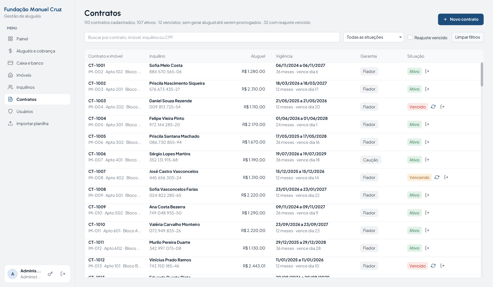
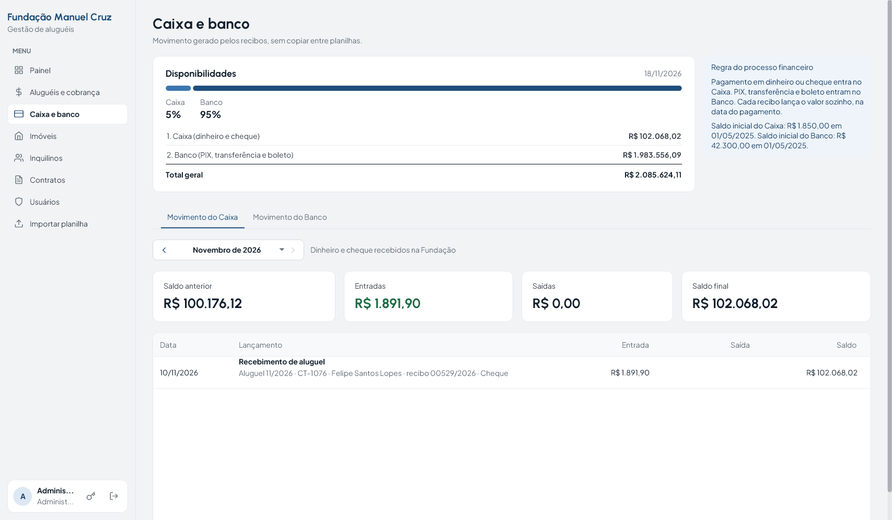

# Sistema Fundação Manuel Cruz

[](https://github.com/EduardoAmericoo/fmc-sistema/actions/workflows/testes.yml)

Sistema de gestão de imóveis e aluguéis para a **Fundação Manuel Cruz** (Aracaju, SE), uma entidade sem fins lucrativos
com 124 imóveis para aluguel que presta contas ao Ministério Público de Sergipe.

A Fundação controlava contratos, aluguéis, cobrança e caixa em papel e em planilhas. O sistema reúne tudo num só lugar:
gera os aluguéis do mês sozinho, calcula multa, juros e correção, emite recibo, organiza a cobrança dos atrasados e
mostra o saldo do Caixa e do Banco. Tudo fica registrado com quem fez e quando, para a prestação de contas.
O cliente validou o protótipo: *"resolve 90% dos meus problemas"*.

| Painel | Aluguéis | Cobrança |
|---|---|---|
|  |  |  |
| **Contratos** | **Recibo em PDF** | **Caixa e banco** |
|  |  |  |

## Testar agora

O sistema é um aplicativo de **Windows**. Ele já abre com dados fictícios para testar: 124 imóveis, 110 inquilinos,
110 contratos e 18 meses de aluguéis, recibos e cobrança.

### Opção 1: baixar o programa pronto (recomendado)

1. Abra a página de [**versões (Releases)**](https://github.com/EduardoAmericoo/fmc-sistema/releases/latest) e baixe o arquivo `.zip`.
2. Extraia o `.zip` numa pasta qualquer, por exemplo na Área de Trabalho.
3. Abra a pasta extraída e dê dois cliques em **`FMC.exe`**.

Não é preciso instalar Java nem nada mais: o programa já vem com tudo.
Na primeira vez, o Windows pode mostrar o aviso **"O Windows protegeu o computador"**, porque o programa é novo e
não tem assinatura digital. Clique em **Mais informações** e depois em **Executar assim mesmo**.

### Opção 2: rodar pelo código

1. Instale o **Java 21** (Temurin): https://adoptium.net (escolha a versão 21 LTS).
2. Baixe o código: no topo desta página, **Code → Download ZIP**, e extraia; ou clone com o Git.
3. Abra o PowerShell dentro da pasta do projeto e rode:

```powershell
.\mvnw.cmd javafx:run
```

Na primeira vez demora alguns minutos, porque o `mvnw` baixa o Maven e as bibliotecas sozinho.

### Acessos para teste

| E-mail | Senha | Perfil | O que vê |
|---|---|---|---|
| `admin@fmc.org` | `Fmc@2026` | Administrador | tudo, inclusive usuários, permissões, importação e cópias |
| `secretaria@exemplo.org` | `teste123` | Secretaria | cadastros, contratos, aluguéis, recebimento e cobrança |
| `financeiro@exemplo.org` | `teste123` | Financeiro | consulta, geração de aluguéis, contatos de cobrança e Caixa |
| `aprendiz@exemplo.org` | `teste123` | Secretaria com uma permissão a menos | igual à Secretaria, mas não cadastra inquilino novo |
| `administrador@exemplo.org` | `teste123` | Administrador | igual ao `admin@fmc.org` |

Estas senhas valem só para os dados fictícios de demonstração. Na versão instalada na Fundação, os dados de teste
ficam desligados (veja [Versão da Fundação](#versão-da-fundação)).

## Roteiro de 5 minutos

1. Entre como **`secretaria@exemplo.org`**. O **Painel** mostra os números do mês e o que precisa de atenção:
   aluguéis atrasados, contratos vencendo, reajustes e promessas de pagamento. Clique numa pendência para ir à tela já filtrada.
2. Em **Aluguéis e cobrança**, clique em **Em atraso** e depois em **Receber** num aluguel. O sistema calcula
   multa, juros e correção. Confirme e veja o **recibo**, que pode ser impresso ou salvo em PDF.
3. Na aba **Para cobrança**, escolha um inquilino e registre um **contato**: não atendeu, prometeu pagar (com a data)
   ou sem acordo. Dali também sai a mensagem pronta por e-mail ou WhatsApp.
4. Em **Caixa e banco**, veja o recebimento lançado sozinho e o saldo do dia.
5. Em **Contratos**, abra os detalhes de um contrato: garantia (fiador ou caução), documentos, **vistorias com fotos**
   e laudo em PDF, prorrogação, reajuste e encerramento.
6. Saia e entre como **`financeiro@exemplo.org`**: os botões de receber e cadastrar não aparecem, porque o perfil não tem
   essas permissões. Como **`admin@fmc.org`**, a tela **Usuários** mostra como liberar ação por ação para cada pessoa.

## Funcionalidades

| Módulo | O que faz |
|---|---|
| Acesso | Login com limite de tentativas; perfis (Administrador, Secretaria, Financeiro) e permissões ajustáveis ação por ação para cada pessoa; senha provisória com troca no 1º acesso; senha forte; bloqueio de usuário; "Esqueci a senha" com código por e-mail |
| Imóveis | Cadastro de casas e apartamentos, filtros, arquivar e reativar; a situação "Ocupado" vem do contrato |
| Inquilinos | Cadastro com CPF validado e máscaras, busca, arquivar e reativar, ficha com o histórico de pagamento e o nível de pagador |
| Contratos | Garantia obrigatória (fiador ou caução de 3 aluguéis) e renda de 3× o aluguel; prorrogar, encerrar e reajuste anual; documentos por etapa; vistorias de entrada e de saída com fotos, comparação, lacre SHA-256 e laudo em PDF |
| Aluguéis | Geração automática contrato por contrato; recebimento com multa, juros e correção; recibo em janela, impressão e PDF; dispensa de encargos com motivo; cancelamento de recibo com estorno |
| Cobrança | Todos os atrasados, do mais antigo ao mais novo; fiador ou caução; histórico de contatos e promessas; mensagem pronta por e-mail ou WhatsApp |
| Caixa e banco | Lançamento automático de cada recibo; saldo do dia e movimento do mês; saldo inicial; depósito e saque entre Caixa e Banco |
| Painel | Pendências com atalho para a tela filtrada |
| Gestão | Importar planilha `.xlsx` (com prévia dos erros, tudo ou nada); cópia de segurança automática ao abrir e ao fechar, manual, para pen drive e restaurar |

Nada é apagado: recibo errado é cancelado com motivo e estorno, e inquilinos, imóveis, documentos e fotos são arquivados.
É uma exigência da prestação de contas.

## Tecnologias e arquitetura

- **Java 21** e **JavaFX 21** (FXML + CSS), com **Maven** (wrapper `mvnw`) e testes em **JUnit 5**.
- Visual: **AtlantaFX** (tema PrimerLight), ícones **Feather** (Ikonli) e fontes Urbanist e Plus Jakarta Sans,
  seguindo o design system da Fundação (azul `#1D4D7A`).
- **SQLite** (`sqlite-jdbc`), **PDFBox** (recibo, laudo e demonstrativo), **Angus Mail** (e-mail SMTP) e
  **fastexcel** (planilhas).

É um **aplicativo de desktop, sem servidor**: a Fundação usa um computador só e não tem equipe de TI. O banco é um único
arquivo SQLite (`data/fmc.db`), fácil de copiar, e por isso a cópia de segurança é automática. A única saída para a
internet é o envio de e-mail; o WhatsApp só abre um link `wa.me` no navegador.

O código é organizado em camadas, cada uma com um papel só:

```
tela (ui)  →  regra de negócio (service)  →  banco (repository)  →  SQLite (db)
                     usando as classes do domínio (model)
```

As permissões são conferidas duas vezes: o botão some na tela e o service recusa a ação.

## Para quem desenvolve

### O que instalar (uma vez só)

1. **JDK 21**: https://adoptium.net (versão 21 LTS).
2. **VS Code**: https://code.visualstudio.com, com a extensão **Extension Pack for Java** (o VS Code sugere sozinho).
3. **GitHub Desktop** (opcional): https://desktop.github.com. No GitHub Desktop: **File → Clone repository**,
   escolha `fmc-sistema` e clique em **Open in Visual Studio Code**.

Não é preciso instalar o Maven: o `mvnw` baixa tudo sozinho.

### Rodar e testar

**No VS Code:** aba *Run and Debug* (Ctrl+Shift+D), escolha **"Rodar o sistema"** e aperte F5. Ela roda sem
depuração: os breakpoints (bolinhas vermelhas) não pausam o sistema. Para investigar um erro passo a passo, escolha
**"Depurar (para quem programa: para nos breakpoints)"**. Aí o sistema para em cada breakpoint e só continua com F5
(parece travado, mas está esperando).

**No PowerShell:**

```powershell
.\mvnw.cmd javafx:run
```

```powershell
.\mvnw.cmd test
```

Os testes rodam num banco temporário, sem mexer no seu. O GitHub Actions roda todos eles em cada Pull Request e em cada
merge na `main`; o merge só é liberado com os testes passando.

O sistema foi feito e testado só no Windows.

### Gerar o FMC.exe (para o Release)

```powershell
.\scripts\gerar-exe.ps1
```

O script compila o sistema e usa o `jpackage` (vem no JDK 21) para montar a pasta `target\pacote\FMC`, com o
`FMC.exe` e um Java embutido, e o arquivo `target\pacote\FMC-Sistema-<versão>-windows.zip`. É esse `.zip` que vai
anexado na página de Releases do GitHub. Ele é portátil: a pessoa extrai e abre, sem instalar nada. A pasta `data`
(banco, documentos e cópias) é criada dentro da pasta `FMC`, ao lado do `FMC.exe`.

### Dados de teste

Na primeira vez que o sistema abre com o banco vazio (logo depois de baixar o projeto ou de apagar a pasta `data/`),
ele carrega sozinho os dados fictícios e avisa numa janelinha. Se o banco já tem algum cadastro, nada é mexido.
Os dados ficam em `src/main/resources/dados-teste/*.csv`; o histórico de 18 meses é montado por `CargaHistoricoTeste`.

**Para apagar tudo e recarregar do zero** (por exemplo, antes de uma apresentação):

- **No VS Code:** escolha **"Rodar com dados de teste (apaga tudo e recarrega)"** e aperte ▶. Depois, volte para
  **"Rodar o sistema"**, senão o F5 apaga tudo de novo na próxima vez.
- **No PowerShell:** `$env:FMC_DADOS_TESTE="recarregar"; .\mvnw.cmd javafx:run`

⚠️ Recarregar **apaga todos os dados** do seu banco local. Cada pessoa tem o seu banco (`data/fmc.db`, que não vai para
o GitHub).

⚠️ Nunca use nomes ou CPFs reais da Fundação como dados de teste.

### Banco de dados

O banco é o arquivo `data/fmc.db`, criado ao abrir o sistema. As tabelas estão em
`src/main/resources/db/schema.sql`, com `CREATE TABLE IF NOT EXISTS`. Mudanças em tabelas que já existem passam por
`db/Migracoes`, para os bancos antigos se ajustarem sozinhos. Não use `;` dentro de comentários do `schema.sql`: o
arquivo é dividido por `;`.

Fora do banco ficam `data/documentos/` (documentos e fotos de vistoria), `data/copias/` (cópias de segurança) e
`data/caixa-de-saida/` (e-mails simulados).

### Onde fica cada coisa

| Pasta | O que vai lá |
|---|---|
| `src/main/java/br/org/fmc/model` | Classes do domínio (Imovel, Inquilino, Contrato, Garantia…), enums e regras simples |
| `src/main/java/br/org/fmc/repository` | SQL com `PreparedStatement`, um repository por assunto |
| `src/main/java/br/org/fmc/service` | Regras de negócio, permissões (`Sessao.exigir`) e transações |
| `src/main/java/br/org/fmc/ui` | Controllers das telas e utilitários de tela |
| `src/main/java/br/org/fmc/db` | Conexão, schema e migrações |
| `src/main/java/br/org/fmc/util` | PDF (recibo, laudo, demonstrativo), e-mail, senha, formatos e EXIF das fotos |
| `src/main/resources/br/org/fmc/ui` | Telas `.fxml` (dá para editar no Scene Builder) |
| `src/main/resources/br/org/fmc/css/tema.css` | Cores e medidas do design system |
| `src/main/resources/db/schema.sql` | Tabelas do banco |
| `src/test/java` | Testes automatizados (JUnit) |

Cada pacote tem um `package-info.java` explicando o que entra nele.

### Visual das telas

- **AtlantaFX** dá a base dos controles e **`css/tema.css`** aplica as cores e medidas da Fundação.
- **Ícones:** pacote Feather do Ikonli. No FXML: `<FontIcon iconLiteral="fth-home"/>`
  (lista: https://kordamp.org/ikonli/cheat-sheet-feather.html).
- **Modelo para telas novas:** a tela de Inquilinos (`inquilinos.fxml` + `InquilinosController`): cabeçalho com título
  e botão principal, tabela num cartão (`tabela-fmc`) e o formulário numa janela por cima (`Navegador.mostrarJanela`).

### Combinados de Git

1. **Ninguém faz commit direto na `main`.** Tudo entra por Pull Request, com os testes passando e 1 aprovação.
2. **Uma tarefa do Plane = uma branch**, no modelo `tipo/BOARD-numero-descricao`.
   Ex.: `feature/BOARD-53-cadastro-usuarios` (tipos: `feature/`, `fix/`, `melhoria/`, `docs/`, `test/`).
3. Antes de criar a branch, atualize a `main` (**Pull**).
4. Commits pequenos, no modelo `tipo(BOARD-numero): o que foi feito`.
   Ex.: `feat(BOARD-53): cria tela de cadastro de usuários`.
5. Antes do Pull Request, o sistema precisa compilar, abrir e passar nos testes.

## Versão da Fundação

Para instalar no computador da Fundação, com dados reais:

1. **Desligue os dados de teste** com a variável de ambiente `FMC_DADOS_TESTE=nao`. Sem ela, o sistema começa com os
   dados fictícios e com o e-mail simulado.
2. **Troque a senha do Administrador** no primeiro acesso, pelo menu "Trocar minha senha".
3. **Configure o e-mail** para o "Esqueci a senha" e as mensagens de cobrança. A senha da conta fica só nas
   variáveis de ambiente do Windows, nunca no código nem no GitHub.

| Variável | Exemplo |
|---|---|
| `FMC_SMTP_HOST` | `smtp.gmail.com` |
| `FMC_SMTP_PORTA` | `587` |
| `FMC_SMTP_USUARIO` | `sistema@fundacao.org` |
| `FMC_SMTP_SENHA` | senha de app da conta (no Gmail: Conta Google → Segurança → Senhas de app) |
| `FMC_SMTP_REMETENTE` | opcional; por padrão, o próprio usuário |

Sem `FMC_SMTP_HOST` e com `FMC_DADOS_TESTE=nao`, a recuperação por e-mail fica desligada e só o Administrador gera
senha provisória.

4. **Proteja os dados pessoais (LGPD):** ligue a criptografia de disco do Windows e salve a cópia de segurança num
   pen drive criptografado. O banco guarda CPFs, rendas e telefones.

## Equipe

Projeto 2 da CESAR School (disciplinas GTI e POO), Grupo 2, em parceria com a Fundação Manuel Cruz.

## Licença

A definir.
