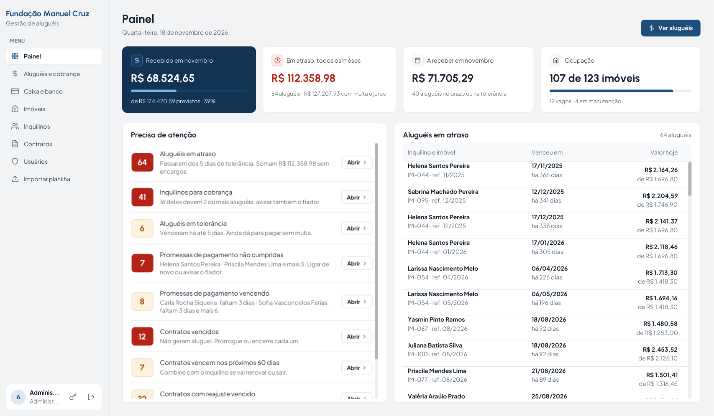
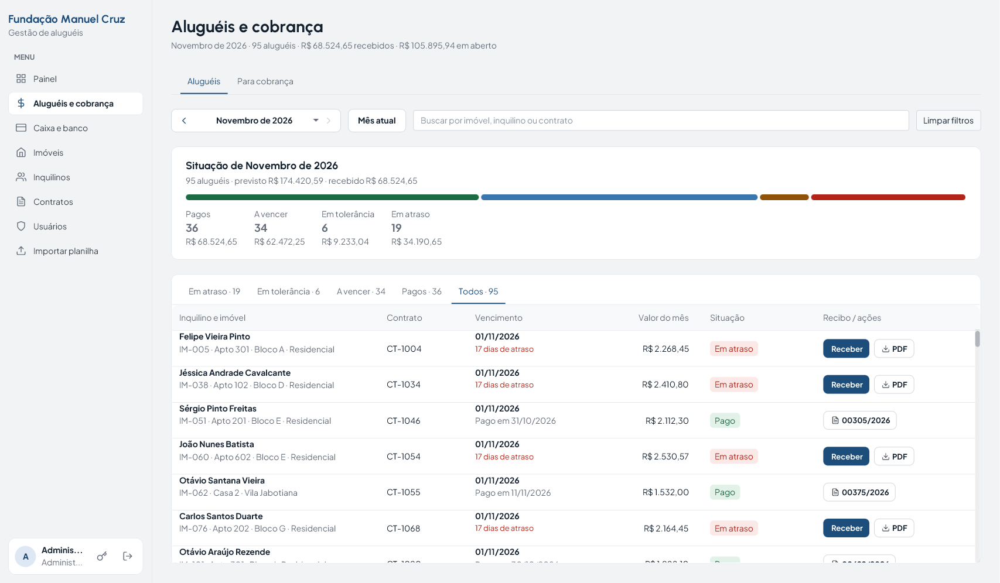
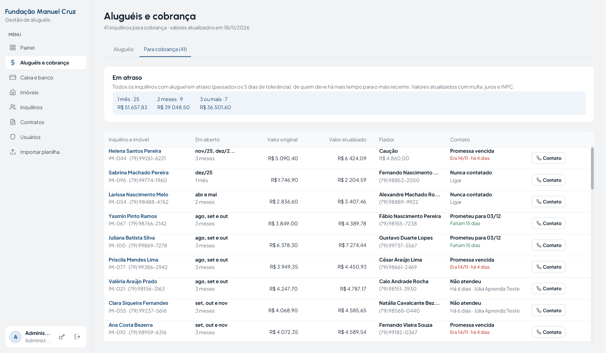
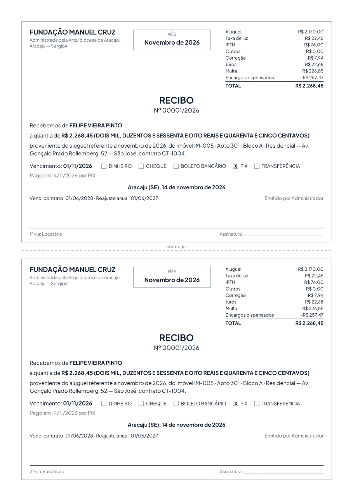

# Sistema Fundação Manuel Cruz

[](https://github.com/EduardoAmericoo/fmc-sistema/actions/workflows/testes.yml)
[](https://github.com/EduardoAmericoo/fmc-sistema/releases/latest)


Sistema de gestão de imóveis e aluguéis para a **Fundação Manuel Cruz** (Aracaju, SE), uma entidade sem fins lucrativos
com 124 imóveis para aluguel que presta contas ao Ministério Público de Sergipe.

A Fundação controlava contratos, aluguéis, cobrança e caixa em papel e em planilhas. O sistema reúne tudo num só lugar:
gera os aluguéis do mês sozinho, calcula multa, juros e correção, emite recibo, organiza a cobrança dos atrasados e
mostra o saldo do Caixa e do Banco. Tudo fica registrado com quem fez e quando, para a prestação de contas.
O cliente validou o protótipo: *"resolve 90% dos meus problemas"*.

| Painel | Aluguéis | Cobrança |
|---|---|---|
|  |  |  |
| **Contratos** | **Recibo em PDF** | **Caixa e banco** |
|  |  |  |

## Testar agora

O sistema é um aplicativo de **Windows**. Ele já abre com dados fictícios para testar: 124 imóveis, 110 inquilinos,
110 contratos e 18 meses de aluguéis, recibos, cobrança e vistorias com fotos.

### Opção 1: instalar o programa (recomendado)

1. Abra a página de [**versões (Releases)**](https://github.com/EduardoAmericoo/fmc-sistema/releases/latest) e baixe
   o **`Instalar-FMC-<versão>.exe`**.
2. Dê dois cliques no arquivo baixado e siga o instalador: **Next → Install → Finish**. O Windows pede a confirmação
   de administrador, como em qualquer programa.
3. Abra o **FMC** pelo ícone que aparece na Área de Trabalho ou no menu Iniciar.

Não é preciso instalar Java nem nada mais: o programa já vem com tudo. Para desinstalar, use
**Configurações → Aplicativos → FMC → Desinstalar**.

Na primeira vez, o Windows pode mostrar o aviso **"O Windows protegeu o computador"**, porque o programa é novo e
não tem assinatura digital. Clique em **Mais informações** e depois em **Executar assim mesmo**.

**Sem permissão para instalar programas?** Na mesma página há o **`FMC-Sistema-<versão>-windows.zip`**, a versão
portátil: extraia, abra a pasta **FMC** e dê dois cliques em **`FMC.exe`**.

### Opção 2: rodar pelo código

Com o **Java 21** instalado ([Temurin](https://adoptium.net), versão 21 LTS), baixe o código (**Code → Download ZIP**)
e, no PowerShell, dentro da pasta do projeto:

```powershell
.\mvnw.cmd javafx:run
```

Na primeira vez demora alguns minutos, porque o `mvnw` baixa o Maven e as bibliotecas sozinho.

### Acessos para teste

| E-mail | Senha | Perfil | O que vê |
|---|---|---|---|
| `admin@fmc.org` | `Fmc@2026` | Administrador | tudo, inclusive usuários, permissões, importação e cópias |
| `secretaria@exemplo.org` | `teste123` | Secretaria | cadastros, contratos, aluguéis, recebimento e cobrança |
| `financeiro@exemplo.org` | `teste123` | Financeiro | consulta, geração de aluguéis, contatos de cobrança e Caixa |
| `aprendiz@exemplo.org` | `teste123` | Secretaria com uma permissão a menos | igual à Secretaria, mas não cadastra inquilino novo |

Estas senhas valem só para os dados fictícios de demonstração. Os nomes, CPFs e fotos são inventados.

## Roteiro de 5 minutos

1. Entre como **`secretaria@exemplo.org`**. O **Painel** mostra os números do mês e o que precisa de atenção:
   aluguéis atrasados, contratos vencendo, reajustes e promessas de pagamento. Clique numa pendência para ir à tela já filtrada.
2. Em **Aluguéis e cobrança**, clique em **Em atraso** e depois em **Receber** num aluguel. O sistema calcula
   multa, juros e correção. Confirme e veja o **recibo**, que pode ser impresso ou salvo em PDF.
3. Na aba **Para cobrança**, escolha um inquilino e registre um **contato**: não atendeu, prometeu pagar (com a data)
   ou sem acordo. Dali também sai a mensagem pronta por e-mail ou WhatsApp.
4. Em **Caixa e banco**, veja o recebimento lançado sozinho e o saldo do dia.
5. Em **Contratos**, abra os detalhes de um contrato: garantia (fiador ou caução), documentos, prorrogação, reajuste e
   encerramento. No contrato encerrado **CT-1043** (filtro **Encerrados**), abra **Vistorias (fotos)** e, na aba
   **Comparar entrada e saída**, veja a sala na entrega das chaves e na devolução, lado a lado; dali sai o laudo em PDF.
6. Saia e entre como **`financeiro@exemplo.org`**: os botões de receber e cadastrar não aparecem, porque o perfil não tem
   essas permissões. Como **`admin@fmc.org`**, a tela **Usuários** mostra como liberar ação por ação para cada pessoa.

## Funcionalidades

| Módulo | O que faz |
|---|---|
| Acesso | Login com limite de tentativas; perfis (Administrador, Secretaria, Financeiro) e permissões ajustáveis ação por ação para cada pessoa; senha provisória com troca no 1º acesso; senha forte; bloqueio de usuário; "Esqueci a senha" com código por e-mail |
| Imóveis | Cadastro de casas e apartamentos, filtros, arquivar e reativar; a situação "Ocupado" vem do contrato |
| Inquilinos | Cadastro com CPF validado e máscaras, busca, arquivar e reativar, ficha com o histórico de pagamento e o nível de pagador |
| Contratos | Garantia obrigatória (fiador ou caução de 3 aluguéis) e renda de 3× o aluguel; prorrogar, encerrar e reajuste anual; documentos por etapa; vistorias de entrada e de saída com fotos, comparação, lacre SHA-256 e laudo em PDF |
| Aluguéis | Geração automática contrato por contrato; recebimento com multa, juros e correção; recibo em janela, impressão e PDF; dispensa de encargos com motivo; cancelamento de recibo com estorno |
| Cobrança | Todos os atrasados, do mais antigo ao mais novo; fiador ou caução; histórico de contatos e promessas; mensagem pronta por e-mail ou WhatsApp |
| Caixa e banco | Lançamento automático de cada recibo; saldo do dia e movimento do mês; saldo inicial; depósito e saque entre Caixa e Banco |
| Painel | Pendências com atalho para a tela filtrada |
| Gestão | Importar planilha `.xlsx` (com prévia dos erros, tudo ou nada); cópia de segurança automática ao abrir e ao fechar, manual, para pen drive e restaurar |

Nada é apagado: recibo errado é cancelado com motivo e estorno, e inquilinos, imóveis, documentos e fotos são arquivados.
É uma exigência da prestação de contas.

## Tecnologias e arquitetura

| Camada | Tecnologia |
|---|---|
| Linguagem e telas | Java 21, JavaFX 21 (FXML + CSS), AtlantaFX, ícones Feather (Ikonli) |
| Banco de dados | SQLite, num único arquivo local |
| Documentos | PDFBox (recibo, laudo de vistoria e demonstrativo), fastexcel (planilhas) |
| E-mail | Angus Mail (SMTP com senha de app) |
| Build e testes | Maven, JUnit 5, GitHub Actions, instalador com `jpackage` |

É um **aplicativo de desktop, sem servidor**: a Fundação usa um computador só e não tem equipe de TI. O banco é um único
arquivo, fácil de copiar, e a cópia de segurança é automática. A única saída para a internet é o envio de e-mail; o
WhatsApp só abre um link `wa.me` no navegador.

O código é organizado em camadas, cada uma com um papel só, o que deixa as regras de negócio testáveis sem abrir telas:

```
tela (ui)  →  regra de negócio (service)  →  banco (repository)  →  SQLite (db)
                     usando as classes do domínio (model)
```

O visual segue o design system da Fundação (azul `#1D4D7A`, fontes Urbanist e Plus Jakarta Sans) e o protótipo
aprovado pelo cliente.

## Qualidade e segurança

- **363 testes automatizados** das regras de negócio, rodando no GitHub a cada mudança. Nenhuma mudança entra sem
  os testes passando.
- **Senhas** guardadas só como hash (PBKDF2 com sal), com senha forte obrigatória e pausa depois de 5 tentativas erradas.
- **Permissões conferidas duas vezes:** o botão some na tela e a regra de negócio recusa a ação.
- **Trilha de auditoria:** recibos, cancelamentos, dispensas, contatos, documentos e fotos guardam quem fez e quando.
- **Fotos de vistoria com lacre:** cada foto guarda a sua impressão digital (SHA-256), que acusa se ela for editada depois.
- **Dados pessoais (LGPD):** os dados ficam só no computador da Fundação, na pasta do usuário do Windows, com cópia de
  segurança automática. Nenhum dado de inquilino vai para a internet.

## Equipe

Projeto 2 da CESAR School (disciplinas GTI e POO), Grupo 2, em parceria com a Fundação Manuel Cruz.

## Licença

**Todos os direitos reservados.** É permitido baixar, compilar e executar o sistema só para avaliação. Copiar,
modificar, distribuir ou usar comercialmente depende de autorização por escrito. Veja o arquivo [LICENSE](LICENSE).
